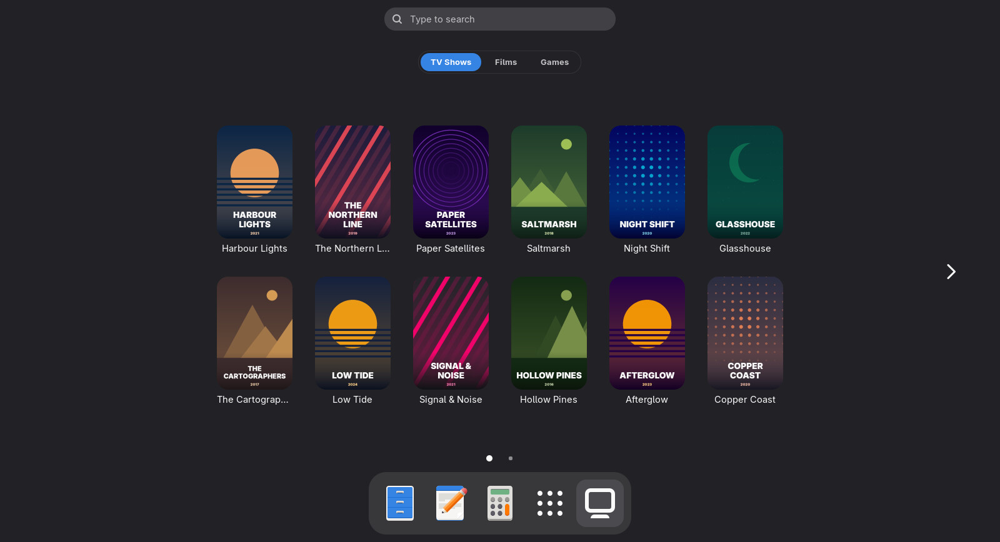
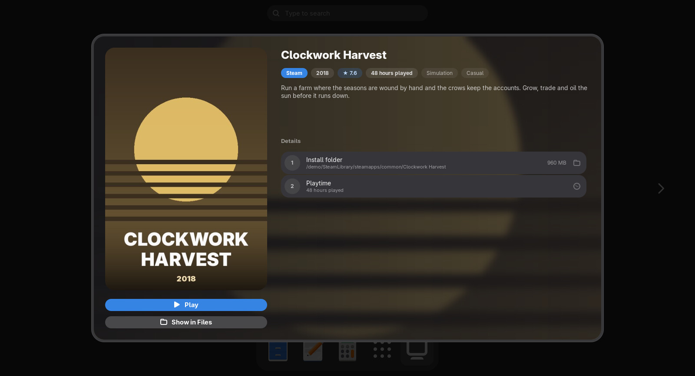
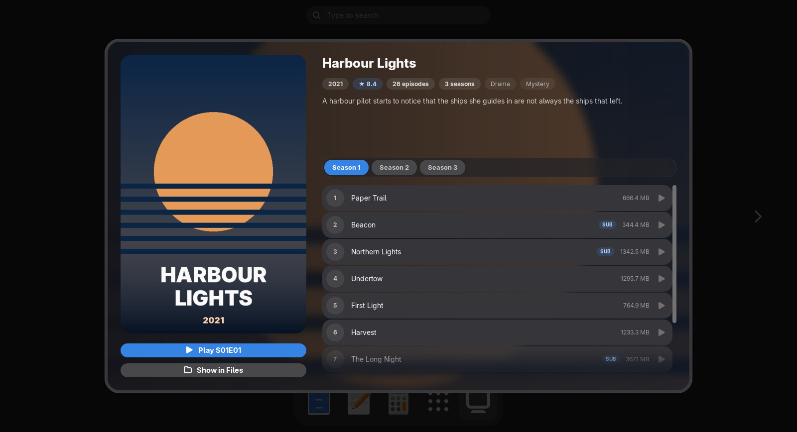
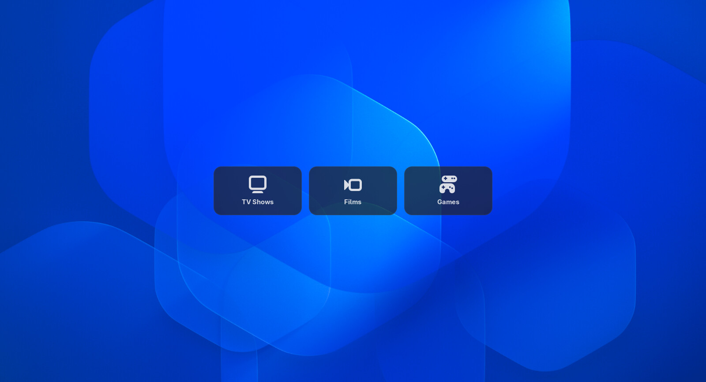
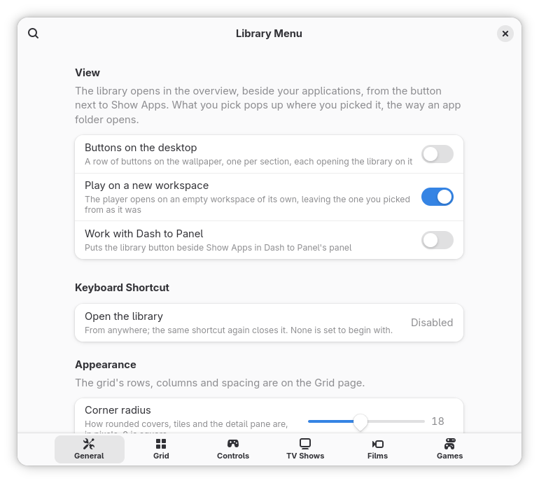

# Library Menu

Your own TV shows, films and games as a library in the overview, opened from a button
beside Show Apps: posters, synopses, seasons and episodes beside your applications.
It plays nothing itself: a show or film
opens in VLC, mpv or whichever player you choose, and it remembers what you have
watched; a game starts through Steam or PCSX2.



## What it does

- **One button, three tabs.** TV Shows, Films and Games, switched at the top. Turn a
  section off and its tab goes. Games are found in Steam's own library files and the
  folders PCSX2 points at, with nothing to set up.
- **Finds the artwork.** Each title is looked up on TVmaze, TMDB and Wikipedia for its
  poster, backdrop, rating and synopsis, and kept in a local cache.
- **Remembers what you have watched.** Tick an episode, or just play it, and Continue
  picks up where you left off.
- **Looks like GNOME.** The grid is the shell's own app grid, in your accent colour,
  with the same paging, swiping and keyboard.
- **Remote or controller.** Map a TV remote's keys or a game controller's buttons, and
  browse from the sofa.

## Games

The Games tab finds your games by itself, with nothing to set up: Steam's own library
files list every installed Steam game, libraries on other drives included, and the
folders PCSX2 is pointed at hold your PlayStation 2 discs. On a first run the empty tab
has a **Find Games** button; after that, **Rescan** on the Games page of the preferences
picks up what you installed since.

- **Play** starts the game the way its launcher would: a Steam game through Steam
  (`steam://rungameid/…`), with your launch options and compatibility tool; a PS2 disc
  in PCSX2, full screen. A disc with no PCSX2 found has no Play button.
- **Show in Files** opens the game's install folder or the disc's folder.
- A Steam game's description, genres and artwork come from Steam's own store, keyless.
  A PS2 disc keeps PCSX2's cover; for its description and a cover PCSX2 lacks, give IGDB
  a Twitch client id and secret on the Games page.
- Steam and PCSX2 are found in their usual places, the Flatpak installs included; the
  Games page takes a different folder for either.



## Where it opens

The library takes the app grid's place in the overview, with the row of workspaces
folded away, and the button beside Show Apps, a keyboard shortcut or a controller's
Home button opens it. A picked show, film or game pops up out of its poster, the way
an app folder opens, and Escape or a click outside puts it back.

**Buttons on the desktop**, off to begin with, draws a row of buttons on the wallpaper,
one per section, each opening the library on that section. Windows cover them as
they cover the wallpaper.

<table>
  <tr>
    <td width="50%"></td>
    <td width="50%"></td>
  </tr>
  <tr>
    <td valign="top">A picked show pops up out of its poster.</td>
    <td valign="top">Buttons on the desktop, one per section.</td>
  </tr>
</table>

## Requirements

- GNOME Shell 50.
- A video player. The default command is VLC's; any other command works, and left
  empty a file opens in your default video app. Watched marks and Continue need a
  player that shows up in GNOME's media controls (MPRIS): VLC, Showtime, Celluloid, or
  mpv with mpv-mpris.
- For games, Steam or PCSX2 (either is enough, neither is needed for TV shows and
  films).
- For game controllers, libmanette, which most desktops already have with WebKitGTK.
  Without it the extension works and controllers are ignored.

The scanner that reads your folders and finds your games runs on GJS, libsoup 3 and
GdkPixbuf, which GNOME Shell itself depends on.

## Privacy and network

The extension itself never goes online. Only the scanner does, when you press
**Rescan** in the preferences (or run `make scan` in a clone), and only for a section
whose **Fetch artwork and descriptions online** switch is on (on by default).

- **Games:** a Steam game's app id goes to Steam's store (`store.steampowered.com`),
  keyless, for its description, and its artwork comes from Steam's CDN when the Steam
  client has not cached it. A PS2 disc's title goes to IGDB (`api.igdb.com`, after a
  token from `id.twitch.tv`) only once you give it a Twitch client id and secret of
  your own; without them a PS2 game keeps PCSX2's cover or a drawn placeholder.
- **What is sent:** each show's or film's title, taken from its folder or file name,
  and its year where known. TVmaze (`api.tvmaze.com`) gets the title; TMDB
  (`api.themoviedb.org`) gets the title, the year and your API key; English Wikipedia
  (`en.wikipedia.org`) gets the title, the year and "film" or "TV series". Posters and
  backdrops are then downloaded from the address the source gives (TMDB's
  `image.tmdb.org`, TVmaze's image server, Wikimedia). Nothing about your files beyond
  the title and year is sent.
- **Keys are yours.** TVmaze and Wikipedia need none. TMDB is skipped until you give it
  a free key of your own from your [TMDB account](https://www.themoviedb.org/settings/api).
  It is stored in your GNOME settings (dconf) in **plain text**, like any other
  setting, and goes only to TMDB. The key row's **Import** reads a key from a file you
  pick; the file dialog opens on `keys/TMDB/API KEY.txt` in your Documents folder if
  there is one.
- **What is stored:** the library index, artwork and fetched descriptions in
  `~/.cache/library-menu@jackicus/`; watched marks and where playback stopped in
  `~/.local/share/library-menu@jackicus/watched.json`. With **Keep marks in** set to
  **Folders** (the default), each library folder also gets a
  `.library-watched.json` with its own marks, so another computer reading the
  same folder sees them; **Local** removes those copies, **Off** stops tracking.
- **What is read:** your library folders, Steam's and PCSX2's own files (where games
  are installed, playtime, PCSX2's game and cover folders), and the media players on your session (over
  MPRIS) to see which of your files is playing and how far. That stays on your
  computer.

This product uses the TMDB API but is not endorsed or certified by TMDB. Show data
comes from [TVmaze](https://www.tvmaze.com/) and synopses from
[Wikipedia](https://www.wikipedia.org/), both under CC BY-SA; game data from Steam's store
and [IGDB.com](https://www.igdb.com/); images keep the licences their sources give them. The artwork is cached for your own library and never
published by the extension.

## Install

Not on extensions.gnome.org yet. From source, which needs `make` and
`glib-compile-schemas` (part of GLib):

```bash
git clone https://github.com/Jackicus/GNOME-Library-Menu.git
cd GNOME-Library-Menu
make install
```

Log out and back in (a Wayland session cannot load an extension it has never seen),
then `gnome-extensions enable library-menu@jackicus`.

TV Shows and Films are empty until they have folders. Open the preferences
(`gnome-extensions prefs library-menu@jackicus`), and on the **TV Shows** and **Films**
pages add your folders and press **Rescan**. Games need nothing: press **Find Games** on
the empty Games tab, or **Rescan** on its page.

- **TV Shows:** one folder per show. Seasons can be subfolders (`Season 2`) or
  `S02E05` in the file names.
- **Films:** one folder or file per film, named `Title (Year)`. The largest video in a
  folder is the film.

A cover image beside the files (`cover.jpg`, `folder.jpg`, `poster.jpg` and the like)
is used as the poster.

To update, `git pull && make install`, then log out and back in. To remove,
`make uninstall`; your cache, watched marks and settings are left as they were.

## Preferences

`gnome-extensions prefs library-menu@jackicus`, or an empty tab's Open Settings
button.

<table>
  <tr>
    <td width="50%"></td>
    <td width="50%"></td>
  </tr>
  <tr>
    <td valign="top"><b>General</b>: the buttons on the desktop (off to begin with),
    playing on a new workspace, the button in Dash to Panel's panel (off to begin with), the keyboard shortcut (none to begin with), the grid's size and shape, watched marks, and Rescan everything.</td>
    <td valign="top"><b>TV Shows</b> and <b>Films</b>: folders, the information
    sources and their keys, and the player command.</td>
  </tr>
  <tr>
    <td width="50%"></td>
    <td width="50%"></td>
  </tr>
  <tr>
    <td valign="top"><b>Games</b>: where Steam and PCSX2 are, if not where they usually
    are, and IGDB's keys for PS2 discs.</td>
    <td valign="top"><b>Controls</b>: remote keys and controller buttons for browsing
    from the sofa.</td>
  </tr>
</table>

## Troubleshooting

The extension logs to the journal under `[Library Menu]`:

```bash
journalctl -f -o cat /usr/bin/gnome-shell | grep -F '[Library Menu]'
```

The preferences, and the scans they start, log in their own process:

```bash
journalctl -f -o cat SYSLOG_IDENTIFIER=org.gnome.Shell.Extensions
```

From a clone, `make status` says whether it is installed and running, and `make logs`
follows both.

- **A tab says "Nothing in Films yet".** The section has no folder, or has not been
  scanned: its Open Settings button opens the preferences, where you add a folder on its
  page and press Rescan.
- **Find Games finds nothing.** Steam or PCSX2 is installed somewhere other than its
  usual place: set the folder on the Games page and press Rescan. PCSX2 writes the file
  that names its disc folders the first time it runs.
- **A PS2 game has no Play button.** PCSX2 itself was not found (its binary, an
  AppImage in `~/Applications`, or the Flatpak).
- **Rescan says "Failed — see logs".** The reason is in the preferences' journal above,
  after `Scanner failed`.
- **No posters.** Check the section's online switch and its sources. TMDB is skipped
  without a key, and a key TMDB rejects is skipped for the rest of the scan. A title no
  source had artwork for is not looked up again for a week, unless you add a source.
- **Nothing is marked as watched.** The player has to show up in GNOME's media controls
  (mpv needs mpv-mpris), and the file has to be in one of the library's folders.
- **A controller does nothing.** libmanette is not installed, or the library is not on
  screen: controllers are read only while it is and no window has the keyboard, except
  Home, which opens it.
- **The preferences take seconds to open.** A library folder is on a network share that
  is offline or has to wake up.

## Development

```bash
make link      # install as a link to src/, for development
make reload    # load your edits into the running shell
make check     # ESLint, the schema, the scanner's imports: what CI runs
```

[CONTRIBUTING.md](CONTRIBUTING.md) has the setup and how changes land; try changes in
the nested shell, `./scripts/nested.sh start --stand-in`, rather than your own
session. [`docs/`](docs/) covers the [shell internals it depends
on](docs/private-api.md), [compatibility](docs/compatibility.md) and
[publishing](docs/publishing.md).

## Licence

GPL-2.0-or-later. See [LICENSE](LICENSE).

## Credits

The screenshots show a made-up library drawn by `scripts/demo_library.py`. None of the
shows, films or games are real, and nothing in them was fetched online. Metadata and artwork in
your own library come from [TVmaze](https://www.tvmaze.com/),
[TMDB](https://www.themoviedb.org/) with your own key, and
[Wikipedia](https://www.wikipedia.org/); games' from Steam and
[IGDB.com](https://www.igdb.com/) with your own Twitch key. VLC is a trademark of
VideoLAN; Steam of Valve; PlayStation of Sony Interactive Entertainment. Library Menu is
not affiliated with any of them.
